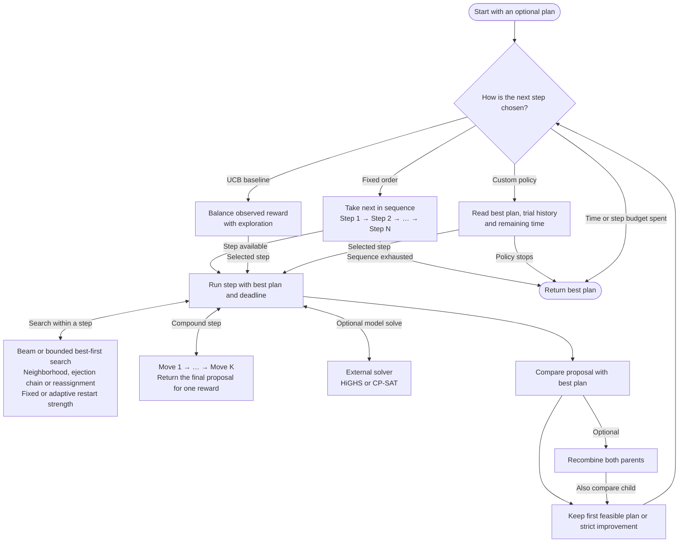

# ShiftOpt

ShiftOpt is a general-purpose discrete optimization solver. We develop our own heuristics and benchmark them on competition problems.

Install the solver with `python -m pip install .`. To run the demos, use `python -m pip install '.[roadef]'`.

## How the solver works

Each demo supplies named steps and a score to minimize. By default the engine runs the steps once in order. A demo can also supply a policy that picks the next step from a fixed list. It can repeat a step or stop early.



The engine owns the deadline, scoring and trial history. The demo defines its moves and when to select them. Each policy call sees which steps ran, whether their proposals were accepted, their rewards and how long they took. Adaptive runs require a finite `max_steps`, including construction.

### Example: packing a bag

Pack as much weight as possible into a bag with capacity 12. The policy starts with greedy packing, tries beam search when time permits, and calls HiGHS if there is still room in the bag.

```python
from time import monotonic
from shiftopt import MAXIMIZE, Model, beam_search, quicksum, run_pipeline

weights = (2, 3, 8, 4)
capacity = 12

def greedy(best, deadline):
    bag = ()
    for weight in weights:
        if sum(bag) + weight <= capacity:
            bag += (weight,)
    return bag

def pack_with_beam(best, deadline):
    def expand(state):
        i, bag = state
        yield i + 1, bag                       # Skip this item.
        if sum(bag) + weights[i] <= capacity:
            yield i + 1, bag + (weights[i],)   # Take this item.

    result = beam_search(
        (0, ()), expand,
        key=lambda state: (state[0], sum(state[1])),
        priority=lambda state: -sum(state[1]),
        complete=lambda state: state[0] == len(weights),
        width=2,
        deadline=deadline,
    )
    return result[1] if result is not None else None

def pack_with_highs(best, deadline):
    model = Model()
    take = [model.addVar(vtype="B") for weight in weights]
    total = quicksum(weight * var for weight, var in zip(weights, take))
    model.addConstr(total <= capacity)
    if best is not None:
        model.addConstr(total >= sum(best))
    model.setObjective(total, MAXIMIZE)
    result = model.optimize(time_limit=max(0, deadline - monotonic()))
    if result.has_solution:
        return tuple(w for w, var in zip(weights, take) if result.value(var) > 0.5)
    return None

def choose_step(best, history, remaining):
    if best is None:
        return greedy
    if sum(best) == capacity:
        return None
    tried = {trial.step for trial in history}
    if pack_with_beam not in tried and remaining > 0.1:
        return pack_with_beam
    if pack_with_highs not in tried:
        return pack_with_highs
    return None

steps = [greedy, pack_with_beam, pack_with_highs]
plan = run_pipeline(steps, score=lambda bag: -sum(bag), seconds=5,
                    policy=choose_step, max_steps=4)
print(plan)  # (8, 4)
```

Greedy takes `(2, 3, 4)` for a total of 9. Inside beam search, `priority` ranks partial bags and `width=2` keeps two alternatives, yielding `(3, 8)` for 11. The last step gives HiGHS one binary variable per item and uses 11 as a lower bound. HiGHS finds `(8, 4)` for 12. The policy sees a full bag and stops. With weights `(6, 6)`, greedy fills the bag immediately and the policy stops after one trial.

### Configure a search step

Using the bag and `greedy` above, this example removes a random subset of packed items and refills the bag in random order. A positive temperature allows temporary setbacks inside the step. Set it to zero for strict improvement. The optional recombination callback builds a bag from the items present in either parent.

```python
from collections import Counter
from shiftopt import neighborhood_search

def remove_items(bag, rng):
    return [weight for weight in bag if rng.random() < 0.5]

def fill(kept, candidates):
    for weight in candidates:
        if sum(kept) + weight <= capacity:
            kept.append(weight)
    return tuple(kept)

def repair_bag(kept, rng, deadline):
    available = list((Counter(weights) - Counter(kept)).elements())
    rng.shuffle(available)
    return fill(kept, available)

def combine_bags(left, right, deadline):
    available = (Counter(left) | Counter(right)).elements()
    return fill([], sorted(available, reverse=True))

def score(bag):
    return -sum(bag)

search = neighborhood_search(remove_items, repair_bag, score,
                             attempts=16, seed=7, temperature=0.5)
plan = run_pipeline([greedy, search], score, recombine=combine_bags, seconds=5)
```

Choose steps in the list or with `policy=`. Each neighborhood step has its own attempt limit, seed and temperature. Positive temperatures use numeric score units. The pipeline tries `recombine` when a step returns a distinct proposal and there is an incumbent and time left. It keeps the best of both parents and the child. Omit the callback to compare just the parents.

### Compare step-selection policies

UCB can choose between a sequence of moves, beam search and neighborhood search. In this bag example, the sequence releases all but the heaviest packed item, then refills the bag in descending weight order. It tries each operator once, then uses mean reward and an exploration bonus. The constructor runs separately from the competing operators.

```python
from shiftopt import bandit_policy, move_sequence

def keep_heaviest(bag, deadline):
    return (max(bag),) if bag else ()

def refill_heaviest(kept, deadline):
    available = (Counter(weights) - Counter(kept)).elements()
    return fill(list(kept), sorted(available, reverse=True))

repack = move_sequence(keep_heaviest, refill_heaviest)
moves = [repack, pack_with_beam, search]
policy = bandit_policy(moves, construct=greedy, exploration=0.5)
plan = run_pipeline([greedy, *moves], score, policy=policy, max_steps=6,
                    gain=lambda old, new: old - new, seconds=5)
```

Tune `exploration` in reward units. By default, a strict improvement earns one. With `gain=`, an accepted move earns the supplied nonnegative gain. Construction, ties and misses earn zero. The [2026 routing demo](demos/roadef/2026/) compares UCB and a manual policy under the same budget.

For assignments that block one another, build a step with `ejection_chain(start, extend, close, score, max_depth=3, max_nodes=16, attempts=100, seed=7)` and include it in the pipeline's step list. The demo opens a partial exchange, proposes which assignment to displace next, and checks whether the chain closes into a feasible plan. The engine searches those alternatives until it finds an improvement or reaches a limit. [2020 scheduling example](demos/roadef/2020/pairs.py)

## Core algorithms

- `restart_strength` controls the number of perturbation moves between local searches.
- `simulated_annealing(move, score, attempts=..., temperature=..., seed=...)` explores feasible moves, can accept uphill costs as it cools, and returns its best plan. Use the resulting step in a fixed pipeline or a step policy.
- `neighborhood_search` runs destroy-and-repair trials with strict or Metropolis acceptance.
- `move_sequence` passes intermediate proposals between moves and scores the final plan once.
- `reassignment_search` tries transfers, rebuilds the affected assignments and compares full plan costs.
- `bounded_best_first` searches across depths with a bounded frontier, retaining improvements across restarts.
- `beam_search` keeps the best partial plans at each search depth.
- `bounded_max_flow` maximizes flow subject to lower and upper edge bounds.
- `select_candidates` selects a high-value subset under resource limits, with optional learned resource prices from `PriceOracle`.
- `Calendar.eligible` filters job starts against resource and inventory limits.
- `Model.fixAndOptimize` fixes selected decisions and reoptimizes the rest with HiGHS.
- `Model.localBranch` searches with HiGHS within a limit on binary decision changes.

## ROADEF/EURO benchmarks

The demos cover all 14 editions in the [ROADEF archive](https://roadef.org/index.php/app/pages/le-challenge-roadef). Historical results identify the instance or set checked. Ranks are retrospective comparisons with published standings.

| Year | Problem | Result |
|---|---|---|
| [1999](demos/roadef/1999/) | Equipment inventory | 16/16 public plans checked. I808nb cost 1,238,300 (reference 1,288,400) |
| [2001](demos/roadef/2001/) | Frequency assignment | fapp01: relaxation level 4, zero mandatory violations |
| [2003](demos/roadef/2003/) | Earth observation scheduling | 10/10 Set A plans accepted. Gain 10,423,440 on 2_9_36 |
| [2005](demos/roadef/2005/) | Car sequencing | 064: 284,648 (input order 284,650) |
| [2007](demos/roadef/2007/) | Technician scheduling | 10/10 Set A plans accepted. data1 cost 7,500 (reference 2,490) |
| [2009](demos/roadef/2009/) | Airline disruption recovery | A05 cost 40,275,051 |
| [2010](demos/roadef/2010/) | Power generation and outages | data0: 0.081% above the best qualification cost, built from scratch |
| [2012](demos/roadef/2012/) | Machine reassignment | a1_1 cost 44,306,804 (initial 49,528,750) |
| [2014](demos/roadef/2014/) | Rolling stock management | B1 cost 2,555,400 (winning team's B1 cost 699,749.94) |
| [2016](demos/roadef/2016/) | Inventory routing | 4th of 8 with B+X scores |
| [2018](demos/roadef/2018/) | Glass cutting | 7th of 20 |
| [2020](demos/roadef/2020/) | Maintenance scheduling | 13th of 14 |
| [2022](demos/roadef/2022/) | Truck loading | 14th of 16 |
| [2026](demos/roadef/2026/) | Traffic routing | Sprint: joint 28th of 54. Qualification: joint 31st of 74. |

## DIMACS benchmarks

Thirty standalone DIMACS demos across eleven editions compare candidate plans or refine an incumbent through the shared pipeline. [Editions, inputs and results](demos/dimacs/).

## MIP Computational Competition

Each edition has an independent pipeline, a small input and checked results on public competition data.

| Edition | Pipeline task |
|---|---|
| [2022](demos/mip/2022/) | Find and improve feasible assignments in linear MIPs |
| [2023](demos/mip/2023/) | Reuse incumbents across a sequence of changed models |
| [2024](demos/mip/2024/) | Reduce models and restore original solutions |
| [2025](demos/mip/2025/) | Search restricted neighborhoods in quadratic MIPs |
| [2026](demos/mip/2026/) | Evaluate batches of integer moves on a GPU |
| [2027](demos/mip/2027/) | Shrink infeasible subsystems and certify the retained elements |

## PACE benchmarks

Each demo runs its own pipeline and writes a solution in the competition format. The edition pages report results on individual public inputs. Exact-track instances can be used to measure heuristic quality. Official rankings require the full competition evaluation.

| Edition | Problems |
|---|---|
| [2016](demos/pace/2016/) | Feedback vertex set, Treewidth |
| [2017](demos/pace/2017/) | Minimum fill-in, Treewidth |
| [2018](demos/pace/2018/) | Steiner tree |
| [2019](demos/pace/2019/) | Hypertree width, Vertex cover |
| [2020](demos/pace/2020/) | Treedepth |
| [2021](demos/pace/2021/) | Cluster editing, Kernelization |
| [2022](demos/pace/2022/) | Directed feedback vertex set |
| [2023](demos/pace/2023/) | Twinwidth |
| [2024](demos/pace/2024/) | One-sided crossing minimization |
| [2025](demos/pace/2025/) | Dominating set, Hitting set |
| [2026](demos/pace/2026/) | Maximum agreement forest |
| [2027](demos/pace/2027/) | Unweighted k-path, Weighted directed k-path |

## CHeSC benchmarks

| Edition | Pipeline benchmark | Result |
| --- | --- | --- |
| [2011](demos/chesc/2011/) | Six HyFlex domains, 30 competition instances | Bandit vs fixed order on one short run: 16 wins, 11 ties, 3 losses |
| [2014](demos/chesc/2014/) | Single-solver and multiple-solver batch formats on the public 2011 set | Both modes improved all 30 starting solutions in a local reproduction |

## International Timetabling Competition

| Edition | Tracks | Results |
| --- | --- | --- |
| [2002](demos/itc/2002/) | University events | Python: competition01 penalty 261 in 60 s. Previous UniTime pipeline: 4th of 12 |
| [2007](demos/itc/2007/) | Exams, post-enrolment, curriculum | Python: exam set 1 scored 8,088, post-enrolment set 5 scored 1,337, curriculum comp01 scored 25. Previous UniTime pipeline: 1st, 6th and 2nd of 6 |
| [2011](demos/itc/2011/) | High-school timetabling | Round 2: 79/180 verified schedules, 269 s per trial. Reconstructed 4th of 5 |
| [2019](demos/itc/2019/) | University classes, rooms and student sectioning | 1/30 feasible from scratch in 60 s each. Four points, reconstructed 6th of 6 |
| [2021](demos/itc/2021/) | Sports timetabling | 0/45 feasible from scratch in 60 s each. Zero points, reconstructed 14th of 14 |

## License

ShiftOpt is licensed under the [GNU Affero General Public License, version 3 only](LICENSE). Third-party benchmark data is subject to its original terms.
