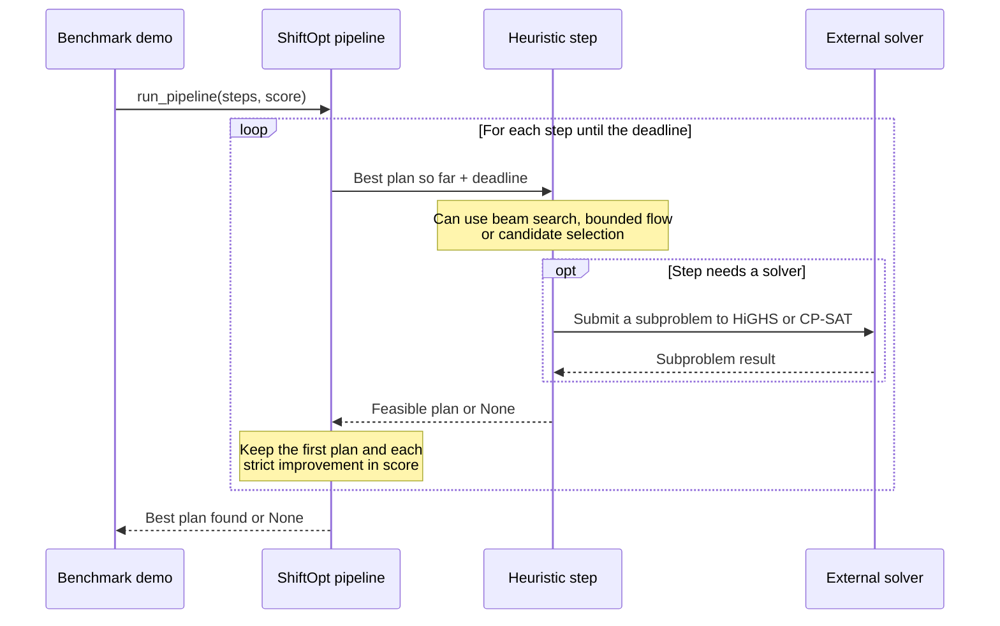

# ShiftOpt

ShiftOpt is a general-purpose discrete optimization solver. We develop our own heuristics and benchmark them on competition problems.

Install the solver with `python -m pip install .`. To run the demos, use `python -m pip install '.[roadef]'`.

## How the solver works

Every demo defines its plan format, scoring function and step order. A step can build a plan from scratch, repair it or refine it. The same pipeline runs all five benchmarks.



### Example: packing a bag

Pack as much weight as possible into a bag with capacity 12. The pipeline tries greedy packing, beam search and a binary optimization model solved by HiGHS.

```python
from time import monotonic
from shiftopt import MAXIMIZE, Model, beam_search, quicksum, run_pipeline

weights = (2, 3, 8, 4)
capacity = 12

def greedy(best, deadline):
    bag = ()
    for weight in weights:
        if sum(bag) + weight <= capacity:
            bag += (weight,)
    return bag

def pack_with_beam(best, deadline):
    def expand(state):
        i, bag = state
        yield i + 1, bag                       # Skip this item.
        if sum(bag) + weights[i] <= capacity:
            yield i + 1, bag + (weights[i],)   # Take this item.

    result = beam_search(
        (0, ()), expand,
        key=lambda state: (state[0], sum(state[1])),
        priority=lambda state: -sum(state[1]),
        complete=lambda state: state[0] == len(weights),
        width=2,
        deadline=deadline,
    )
    return result[1] if result is not None else None

def pack_with_highs(best, deadline):
    model = Model()
    take = [model.addVar(vtype="B") for weight in weights]
    total = quicksum(weight * var for weight, var in zip(weights, take))
    model.addConstr(total <= capacity)
    if best is not None:
        model.addConstr(total >= sum(best))
    model.setObjective(total, MAXIMIZE)
    result = model.optimize(time_limit=max(0, deadline - monotonic()))
    if result.has_solution:
        return tuple(w for w, var in zip(weights, take) if result.value(var) > 0.5)
    return None

steps = [greedy, pack_with_beam, pack_with_highs]
plan = run_pipeline(steps, score=lambda bag: -sum(bag), seconds=5)
print(plan)  # (8, 4)
```

Greedy takes `(2, 3, 4)` for a total of 9. Inside beam search, `priority` ranks partial bags and `width=2` keeps two alternatives, yielding `(3, 8)` for 11. The last step gives HiGHS one binary variable per item and uses 11 as a lower bound. HiGHS finds `(8, 4)` for 12. Across all three steps, the pipeline compares complete bags using `score`.

## Core algorithms

- `beam_search` keeps the best partial plans at each search depth.
- `bounded_max_flow` maximizes flow subject to lower and upper edge bounds.
- `select_candidates` selects a high-value subset under resource limits, with optional learned resource prices from `PriceOracle`.
- `Calendar.eligible` filters job starts against resource and inventory limits.
- `Model.fixAndOptimize` fixes selected decisions and reoptimizes the rest with HiGHS.
- `Model.localBranch` searches with HiGHS within a limit on binary decision changes.

## ROADEF/EURO benchmarks

Ranks show where ShiftOpt would place in the published standings.

| Year | Problem | Rank |
|---|---|---|
| [2016](demos/roadef/2016/) | Inventory routing | 4th of 10 |
| [2018](demos/roadef/2018/) | Glass cutting | 7th of 20 |
| [2020](demos/roadef/2020/) | Maintenance scheduling | 13th of 14 |
| [2022](demos/roadef/2022/) | Truck loading | 14th of 16 |
| [2026](demos/roadef/2026/) | Traffic routing | Sprint: joint 30th of 54. Qualification: joint 31st of 74. |
